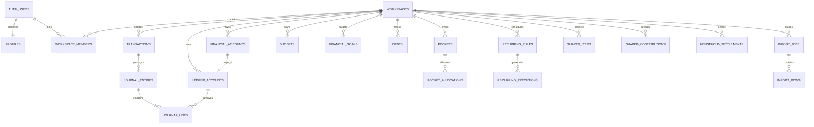

#**Product-owner decision (2026-11-21): Option A approved.** Eligible funds include active cash, bank and e-wallet balances only. Positive balances contribute; negative/overdraft balances reduce the aggregate eligible funds. Exclude credit-card available credit/limits, receivables and archived accounts. Pocket allocations are virtual and create no journal entries. `Unallocated = eligible funds − total allocated` is derived and may become negative after spending or another balance change; the UI must clearly show the shortfall. New allocations must be rejected if they would increase an existing shortfall or cause total allocations to exceed eligible funds. Deallocation remains allowed during a shortfall, and a pocket-to-pocket transfer must preserve total allocations. Allocation validation and writes must be serialized atomically to prevent concurrent over-allocation. Foreign-currency conversion basis, rate source and as-of timestamp remain dependent on D-18/D-19; do not invent a rate or valuation method. Household/private-fund eligibility remains subject to G5. This decision does not authorize migrations or implementation.

### 17.17 D-15 — Multiple partial refunds approved

### 17.18 D-16 — Cash-like pocket eligibility and shortfall approved

**Product-owner decision (2026-11-21): Option A approved.** An eligible original expense may receive multiple linked partial refunds over time, or one full refund. Each refund is a separate posted business event that offsets the original expense; it is not income and is not an error-correction reversal. Before posting, calculate the remaining refundable amount as the original refundable amount less all successful prior refunds linked to that original. The cumulative successful refund amount must never exceed the original refundable amount. The refund RPC must lock the original transaction before checking the remainder, enforce canonical idempotency and concurrency controls, and commit the refund transaction and journal atomically. Detailed multi-currency carrying-value treatment, fees/return adjustments, and refunds paid to a different account remain G2 design deliverables. This decision does not approve final RPC signatures or authorize migrations/implementation.

 POCKA V1 — Database & Finance Architecture Design Pack

**Status:** Proposed design baseline — pending product-owner and architecture review  
**Prepared:** 2026-11-21  
**Scope:** Documentation only. This is not executable SQL, generated types, migrations, or authorization policy code.

> This pack consolidates the database and financial-engine design needed before implementation. Approved ADRs remain authoritative. Any item marked **Pending** must not be silently implemented. Names, signatures and role rules below are proposed contracts until approved.

## 1. Purpose and design status

This pack converts the conceptual `DATABASE_SPECIFICATION.md`, `ARCHITECTURE.md`, `HOUSEHOLD_PRIVACY.md`, ADR-001…ADR-014 and the V1 decision backlog into a reviewable implementation design.

It covers:
1. Canonical entity relationships and data ownership.
2. Proposed schema conventions and data dictionary boundaries.
3. Chart-of-accounts structure and journal-posting matrix.
4. RPC command contracts, idempotency and concurrency.
5. RLS and role/visibility matrix.
6. Pocket eligible-funds policy alternatives.
7. FX carrying-value and rate-provider decisions.
8. Household paired entries and settlement access.
9. Migration sequence, testing, rollback and data lifecycle.

**No implementation authorization is implied.** Phase 0B remains unstarted until the product owner approves the relevant gates and explicitly authorizes coding.

## 2. Binding invariants

The following are binding because they come from approved ADRs or existing approved architecture:

- **ADR-001 + D-12 (Option A approved 2026-11-21):** all money is integer minor units in PostgreSQL `BIGINT`; currency exponent comes from currency metadata; never use JavaScript floating-point arithmetic for money. **Every monetary JSON value, regardless of magnitude, is a base-10 decimal integer string in minor units** and is validated then parsed to TypeScript `bigint`. Monetary JSON numbers are prohibited.
- **ADR-002:** pockets are workspace-level virtual allocations, not assets; no journal lines; mandatory Unallocated is calculated, not stored.
- **ADR-003:** `shared_summary` whitelist is empty. No automatic disclosure of salary, income, balances, net worth or personal transaction aggregates.
- **ADR-004:** recurring occurrences create drafts only; drafts have no journal lines and affect no balances/reports.
- **ADR-005:** contribution and reimbursable advance are distinct; commitments are not cash; reimbursement clears payable/receivable and creates no second expense.
- **ADR-006:** FX snapshots are frozen; only realized FX gain/loss is posted; no unrealized revaluation in V1.
- **ADR-007:** credit cards are liability accounts; bill payment is not a second expense.
- **ADR-008:** accounts with posted history are archived, not hard-deleted.
- **ADR-009:** household access is revoked immediately on exit/removal; financial history and obligations remain.
- **ADR-010:** split totals equal the expense exactly; largest-remainder rounding with deterministic participant-order tie-break.
- **ADR-011:** Bahasa Indonesia, `id-ID`, IDR and `Asia/Jakarta` defaults.
- **ADR-013:** private personal records remain private; household roles never override privacy; sharing uses explicit whitelisted projections.
- **ADR-014:** Cloudflare Workers + Static Assets hosts the frontend; Supabase remains the backend/auth/database.
- Every posted journal entry balances in base currency. Posted entries are immutable; corrections use reversal/repost.
- Every workspace-owned record is scoped to a workspace. Cross-workspace references are rejected except for specifically designed private household paired-entry correlation.
- RLS is enabled on every user/workspace-owned table. Service-role credentials never reach the browser.

## 3. Canonical domain model and ERD

### 3.1 Proposed canonical entities

The following names are canonical candidates for design review, not approved final table names. Consolidation choices must be resolved before migrations.

**Identity and workspace**
- `profiles`: user-facing identity fields; primary key references `auth.users.id`.
- `user_settings`: per-user theme, locale, default workspace and supported preferences.
- `workspaces`: `personal` or `household`, base currency, timezone and locale.
- `workspace_members`: workspace/user membership, role and lifecycle status.
- `workspace_invitations`: invitation metadata and hashed token; never store raw reusable tokens.
- `currencies`: read-only ISO currency reference and minor-unit exponent.

**Ledger and financial accounts**
- `ledger_accounts`: chart-of-accounts records, classified as asset/liability/equity/income/expense.
- `financial_accounts`: user-facing bank/e-wallet/cash/credit-card records mapped one-to-one to ledger accounts.
- `transactions`: business-event header, status, date, classification, source and idempotency identity.
- `journal_entries`: posted accounting event(s) associated with a transaction.
- `journal_lines`: debit/credit lines with original-currency and base-currency amounts.
- `transaction_reversals`: immutable link between original, reversal and optional replacement.
- `idempotency_keys`: optional generalized request ledger if per-entity unique keys prove insufficient.
- `audit_logs`: append-only security and financial audit events.
- **D-13 Option A approved (2026-11-21):** account balance and reporting read models begin with SQL views derived from the authoritative ledger. No separately stored balance/cache table by default; materialization requires measured performance need and reconciliation tests.

**Classification and planning**
- `transaction_categories`, `income_sources`.
- `pockets`, `pocket_allocations`; pocket balances and Unallocated are derived views/functions.
- `budgets`, `budget_categories`, `budget_adjustments`.
- `financial_goals`, `goal_milestones`; goal contributions should reuse pocket allocations where the final design confirms equivalence.
- `debts`, `debt_installments`, `debt_payments`, `debt_payment_allocations`.
- `recurring_rules`, `recurring_executions`; skip state belongs on execution rows, not a separate table unless a concrete need emerges.

**FX and import**
- `exchange_rates`: sourced rate observations, with provider/manual provenance.
- `fx_conversions`: immutable rate snapshot and carrying/settlement values used by posted conversions.
- `import_jobs`, `import_rows`, `import_mappings`, `reconciliation_matches`.
- Private Storage object metadata for import files and transaction attachments.

**Household**
- `shared_items`: explicit, whitelisted projection; never a join path to private source rows for household members.
- `shared_item_events`: grant/update/revoke audit.
- `shared_contributions`: commitments only; no journal impact.
- `contribution_payments`: actual transfer or direct-payment event with funding intent.
- `shared_expense_splits`: split header and participant allocations.
- `household_settlements`, `settlement_allocations`.
- `cross_workspace_links`: proposed private correlation object; exact schema and service-side authorization require review.

### 3.2 Relationship diagram (conceptual)

This diagram intentionally omits some optional and cross-workspace relationships. Final ERD must add cardinality, nullability, delete/archive behaviour and same-workspace constraints for every FK.

### 3.3 Global schema conventions

| Concern | Proposed contract |
|---|---|
| Primary key | UUID, generated by PostgreSQL |
| Workspace scope | `workspace_id NOT NULL` on every workspace-owned row |
| Same-workspace references | Composite unique/FK on `(workspace_id, id)` where a child references a workspace-owned parent |
| Timestamps | `timestamptz`, UTC storage; explicit timezone at presentation |
| Business dates | PostgreSQL `date`; never derive from UTC timestamp |
| Money | `BIGINT` minor units with currency code |
| FX/ratios | `NUMERIC`; never float types |
| Wire money | Decimal integer string; parse to `bigint` |
| IDs | UUID strings |
| Status | CHECK constraint or enum; exact choice is a Phase 0B/Phase 2 design detail |
| Delete | Restrict deletion of posted facts; archive mutable master data with history |
| Audit | Append-only event rows for privileged/financial actions |
| RLS | Enabled in the same migration that creates each owned table |

### 3.4 Minimum data dictionary requirements

Before any migration, each final table must have a reviewed data-dictionary entry containing:
- Purpose and owning bounded context.
- Column name, PostgreSQL type, nullability, default and validation.
- PK, unique constraints, FK and same-workspace guarantee.
- Indexes and expected query patterns.
- Workspace scope, owner field and visibility model.
- Allowed CRUD operations by role.
- Lifecycle: draft, active, posted, archived, revoked, deleted (where permitted).
- Retention and audit expectations.
- Whether data is authoritative, derived, cached or a projection.
- Tests covering constraints, RLS and lifecycle.

## 4. Proposed chart of accounts (CoA)

### 4.1 Account classes and normal balances

| Class | Normal balance | Purpose | Examples |
|---|---|---|---|
| Asset | Debit | Resources owned/controlled | Cash, bank, e-wallet, receivable from household |
| Liability | Credit | Amounts owed | Credit card payable, loan payable, payable to member |
| Equity | Credit | Opening balance and household funding/equity | Opening balance equity, member contribution funding |
| Income | Credit | Earned income | Salary, freelance, business income |
| Expense | Debit | Consumption/cost | Food, transport, household contribution, interest, fees |
 
### 4.2 System-account blueprint

Each workspace receives only the system accounts needed for its type and enabled V1 capabilities.

**Personal workspace candidates**
- Opening Balance Equity.
- Realized FX Gain and Realized FX Loss.
- FX Rounding (if approved).
- Receivable from Household (per household relationship or a controlled counterparty subledger).
- Household Contribution expense ledger account (system account); the similarly named transaction category is a separate classification dimension.
- Interest Expense and Fee Expense where debt/card workflows need them.

**Household workspace candidates**
- Opening Balance Equity.
- Realized FX Gain/Loss and FX Rounding (if approved).
- Payable to Member (per member/counterparty subledger).
- Member Contribution Funding (equity-style classification proposed; requires approval).
- Stable household income/expense control accounts; user-configured categories remain separate classification dimensions.

**Approved D-09 (2026-11-21): categories are dimensions, not ledger accounts.** Do not create one ledger account per UI category and do not store a category-to-ledger-account mapping. Income/expense categories classify transactions and drive category-level reports/budgets; journal lines post to stable ledger accounts selected by the posting rules. The final CoA account list and posting mappings still require G2 review.

### 4.3 CoA design rules

- System accounts have stable system codes; labels may be localized.
- Categories have `kind` (`income` or `expense`) for validation, but never determine or change the accounting class of a ledger account.
- Category create/rename/archive/reassignment does not create, rename, archive, or remap ledger accounts. Historical transaction reporting must retain a defined category identity/snapshot policy.
- Asset/liability accounts carry a currency code. Income/expense account currency behaviour must be specified for base-currency and original-currency reporting.
- A ledger account referenced by posted lines cannot be deleted; archive it.
- A financial account maps to exactly one ledger account. Credit card maps to liability; other wallet types map to asset.
- Same-workspace composite FKs prevent a transaction from referencing another workspace's account/category.
- Counterparty subledgers (member payable/receivable) need uniqueness and lifecycle rules; do not create arbitrary duplicate system accounts.

## 5. Journal posting matrix

**Product-owner approval (2026-11-21):** The matrix below is approved as the V1 backend accounting baseline under D-10. Amounts are positive minor-unit values. Debit/credit lines are generated server-side; all entries must balance in base currency. Adjustment posting requires reason-specific rules before that adjustment type is implemented. Detailed multi-currency and partial-refund edge cases remain subject to their relevant design decisions. User-facing input fields and form flow are a separate UX specification and are not approved by this matrix.

| Event | Debit | Credit | P&L treatment |
|---|---|---|---|
| Opening balance | Asset | Opening Balance Equity | None |
| Income received | Asset | Stable income control account | Income; category is transaction metadata/dimension |
| Expense paid | Stable expense control account | Asset | Expense; category is transaction metadata/dimension |
| Transfer own accounts | Destination asset | Source asset | None |
| Refund | Asset | Original expense (offset) | Reduces expense |
| Adjustment | Approved asset/equity/adjustment pair | Counter-line | Depends on approved reason |
| Credit-card purchase | Stable expense control account | Card liability | Expense once; category is transaction metadata/dimension |
| Credit-card bill payment | Card liability | Bank asset | None |
| Loan disbursement | Cash/bank asset | Loan liability | None |
| Principal repayment | Loan liability | Cash/bank asset | None |
| Interest/fee repayment | Interest/fee expense | Cash/bank asset | Expense |
| FX conversion, gain | Destination asset (settlement value) | Source asset (carrying value) + realized FX gain | Realized gain |
| FX conversion, loss | Destination asset + realized FX loss | Source asset (carrying value) | Realized loss |
| Pocket allocation/deallocation | No journal lines | No journal lines | None |
| Goal contribution | No journal lines | No journal lines | None |
| Recurring draft creation | No journal lines | No journal lines | None until confirmed |
| Household commitment | No journal lines | No journal lines | None |
| Household actual contribution transfer | Household asset | Member contribution funding | None |
| Household direct payment, contribution intent | Household expense | Member contribution funding | Household expense |
| Personal contribution-intent direct payment | Household Contribution expense | Personal asset | Personal expense |
| Household reimbursable advance | Household expense | Payable to member | Household expense |
| Personal side of reimbursable advance | Receivable from Household | Personal asset | None |
| Household reimbursement | Payable to member | Household asset | None |
| Personal reimbursement receipt | Personal asset | Receivable from Household | None |
| Settlement | Payable/receivable | Asset | None |

### 5.1 Posting invariants and edge conditions

1. Every posted journal has at least two positive lines and total debits equal total credits.
2. A posted transaction has exactly the required journal entry set; drafts have none.
3. Refunds link to original transaction and cumulative refunds cannot exceed refundable remainder.
4. Transfer source and destination must differ and have compatible conversion handling.
5. Card bill payment cannot debit expense.
6. Loan principal cannot be classified as expense; interest/fees are expenses.
7. Contribution and reimbursable advance are distinct intents from input through both workspaces.
8. Commitment never increases cash.
9. Reimbursement never posts a second expense.
10. Settlement affects only assets and receivable/payable accounts.
11. Pocket allocation and goal contribution never create journal lines.
12. Reversal mirrors original posted lines and links to the original. Reversal cannot be edited after posting.
13. Partial multi-currency conversion must use the approved carrying-value method; do not prorate using an assumed method before D-18 is resolved.
14. Rounding is performed once at the defined conversion boundary using the approved half-even policy; allocation remainder follows ADR-010 where applicable.

## 6. RPC command contracts

**Status:** RPC-only financial mutations are approved under D-11 Option A (2026-11-21). This catalogue describes the proposed contract shape, not final SQL signatures.

### 6.1 Common command envelope

Every financial command should accept:
- `p_workspace_id`: UUID.
- `p_idempotency_key`: client-generated UUID or opaque high-entropy key, unique within workspace and operation scope.
- `p_request_version`: integer contract version.
- `p_payload`: operation-specific typed fields; avoid a loosely typed generic transaction blob.
- Optional `p_expected_version` for optimistic concurrency on mutable planning objects.

Every response should include:
- `transaction_id` and/or stable resource ID.
- `status` and `posted_at` where relevant.
- `journal_entry_ids` when posted.
- Canonical monetary amounts as base-10 decimal integer strings in minor units, regardless of magnitude; never JSON numbers.
- `replayed` boolean to distinguish idempotent retry from first execution.
- Stable `error_code` and safe localized display message on failure.

Database functions must derive the actor from `auth.uid()`; never trust a caller-supplied user ID for authorization.

### 6.2 Command catalogue and required behaviour

| Command (proposed) | Input essentials | Output | Required guards |
|---|---|---|---|
| `create_opening_balance` | account, amount, currency, date | transaction + journal IDs | one-time per account or explicit adjustment; balanced |
| `post_income` | account, category, amount, currency, date, source | posted transaction | same workspace; account active; valid category kind |
| `post_expense` | account, category, amount, currency, date | posted transaction | same workspace; account active; valid expense category |
| `post_transfer` | source, destination, amount, FX snapshot if needed | posted transaction | source ≠ destination; funds/overdraft policy |
| `post_refund` | original transaction, amount, destination | posted refund | refundable remainder; original eligible |
| `post_adjustment` | account, reason, counter-account, amount | posted transaction | reason allowlist; elevated permission/audit |
| `reverse_journal_entry` | original ID, reason, idempotency key | reversal IDs | original posted; not already reversed beyond policy |
| `post_credit_card_purchase` | card, category, amount, date | posted transaction | card liability mapping; active card |
| `post_credit_card_payment` | card, bank, amount, date | posted transaction | card liability and bank asset; no expense line |
| `post_debt_disbursement` | debt, destination account, amount | posted transaction | liability mapping and same currency/FX rules |
| `post_debt_payment` | debt, account, principal, interest, fee | posted transaction | component sum equals total |
| `create_pocket_allocation` | pocket, amount, direction, date | allocation ID + derived totals | eligible funds; lock/concurrency policy |
| `confirm_recurring_draft` | execution/draft ID | posted transaction | draft exists; idempotent; same posting path |
| `post_fx_conversion` | source, destination, amounts, rate snapshot | posted transaction + FX result | D-18 method; frozen snapshot |
| `create_shared_expense` | household account, participants, split inputs | shared transaction + split rows | role; exact split total; household-only |
| `record_contribution_payment` | commitment, intent, payment kind, amount, paired-link request | household and optional personal-side references | ADR-005; explicit authorization on both sides |
| `settle_household_obligation` | obligation allocations, payment account | settlement + journal IDs | active/obligation-scoped access; no over-settlement |
| `commit_import_rows` | import job, approved row IDs | per-row result summary | approved rows only; same posting functions; partial commit |

### 6.3 Stable error taxonomy

Proposed codes:
- `AUTH_REQUIRED`
- `WORKSPACE_ACCESS_DENIED`
- `ROLE_INSUFFICIENT`
- `VALIDATION_FAILED`
- `CURRENCY_PRECISION_INVALID`
- `INSUFFICIENT_ELIGIBLE_FUNDS`
- `IDEMPOTENCY_CONFLICT`
- `RESOURCE_ARCHIVED`
- `POSTED_ENTRY_IMMUTABLE`
- `REFUND_EXCEEDS_ORIGINAL`
- `SPLIT_TOTAL_MISMATCH`
- `FX_SNAPSHOT_REQUIRED`
- `IMPORT_ROW_NOT_REVIEWED`
- `CONCURRENT_MODIFICATION`
- `CROSS_WORKSPACE_REFERENCE`
- `OBLIGATION_ALREADY_SETTLED`

Error responses must not reveal whether an unauthorized private record exists. User-facing text is localized separately from stable machine codes.

## 7. Idempotency, concurrency and transaction boundaries

### 7.1 Idempotency

- Enforce uniqueness in the database, not only in the client.
- Scope keys to (workspace_id, operation_name, idempotency_key); persist a normalized request fingerprint.
- Same key + same fingerprint returns the original result with `replayed=true`.
- Same key + different fingerprint returns `IDEMPOTENCY_CONFLICT`.
- The key record, business transaction, journal rows and audit event commit atomically.
- Import key convention may be `import:{job_id}:{row_id}`; recurring identity is unique `(rule_id, occurrence_date)`.
- Retrying after timeout must never duplicate ledger effects.

### 7.2 Concurrency

Recommended approach for Phase 2 design review:
1. Lock affected ledger account rows in deterministic UUID order to avoid deadlocks.
2. For pocket allocations, serialize by workspace or lock a dedicated workspace allocation-control row before calculating eligible funds and inserting allocation rows.
3. For refunds and settlements, lock the original transaction/obligation row before computing remaining refundable/settleable amount.
4. For recurring executions and import rows, rely on unique constraints plus row locks.
5. Define transaction isolation and retryable SQLSTATE mapping; do not assume application-side checks are sufficient.

The final lock strategy, lock ordering and retry policy must be tested with concurrent integration tests before release. No authoritative balance may be computed and validated solely in the browser.

### 7.3 Atomicity and audit

A successful financial command writes all required records in one database transaction: command/idempotency record, business header, journal entry/lines, relevant balance/read-model update if any, and audit event. A failure writes none of the financial effects. If a non-financial job requires partial progress (e.g. import), each approved row is an independently atomic posting with a durable per-row outcome.

## 8. RLS and permission matrix

**Status:** deny-by-default RLS is approved. Exact role set and per-action permissions remain proposed (D-21/P-02). The matrix below is the recommended starting point and requires product-owner approval before household implementation.

### 8.1 Visibility rules

| Record scope | Personal workspace | Household workspace |
|---|---|---|
| Private | Owner only | Record owner only; never household-admin bypass |
| Shared | Not applicable for personal records | Active members, subject to role for writes |
| Shared summary | Not used | Denied in V1; whitelist empty |
| Explicit shared projection | Only source owner controls grant/revoke | Only whitelisted projected fields while active |

Membership is necessary for household data but not sufficient to read every private record. Roles govern allowed actions, not visibility of private personal data.

### 8.2 Proposed action matrix

Legend: **R** read shared workspace data; **C** create shared data; **U** update shared mutable data; **M** manage members/settings; **—** denied. All actions remain constrained by record scope, workspace type, ownership, and field-level rules.

| Operation | Owner | Admin | Editor | Viewer |
|---|---:|---:|---:|---:|
| Read shared household records | R | R | R | R |
| Create shared transaction/expense | C | C | C | — |
| Edit own unposted draft | U | U | U | — |
| Edit another member's unposted draft | U* | U* | — | — |
| Post/reverse shared financial record | C/U* | C/U* | C/U* | — |
| Manage categories/budgets/pockets | U | U | U | — |
| Manage household settings | M | M* | — | — |
| Invite/remove members | M | M* | — | — |
| Transfer ownership / delete household | M* | — | — | — |
| Read a member's private personal workspace | — | — | — | — |
| Read private source record behind projection | — | — | — | — |
| Grant/revoke own shared projection | Own records only | — | Own records only | Own records only |
| Read approved active projection | R | R | R | R |
| Read shared_summary | — | — | — | — |
| Settle an obligation after leaving | Scoped obligation only | Scoped obligation only | — | Scoped obligation only |

`*` = proposed restriction requiring final approval. Last-owner protection and ownership transfer require dedicated rules.

### 8.3 Table-family RLS baseline

| Table family | SELECT rule | Write rule | Special boundary |
|---|---|---|---|
| profiles | Own profile; restricted public member fields via view | Own safe fields | No financial data |
| user_settings | Own row | Own row | No household access |
| workspaces/members | Active member sees household metadata; personal owner sees own | Role-specific RPC | Last-owner protection |
| ledger/accounts/transactions | Personal owner; household active member only for shared rows | RPC-only proposed; role + scope | Private household drafts owner-only |
| journal entries/lines | Same as parent transaction, through safe read path | No direct client writes | Immutable after post |
| categories/sources | Workspace-scoped; private income sources remain private | Role-specific | Source ≠ category |
| pockets/budgets/goals/debts | Workspace + scope + role | Role-specific RPC | Derived figures reconcile |
| recurring | Workspace member; owner restrictions for private templates | Owner/editor rules | Draft-only generation |
| FX | Authenticated read of approved global rates; workspace manual rates scoped | Controlled server/RPC | Posted snapshots immutable |
| shared items/events | Active household members see allowed projection only | Owner grant/revoke | Never expose source_id join |
| contributions/splits/settlements | Household members and obligation parties per rules | RPC-only proposed | Exit-safe scoped obligations |
| import jobs/rows | Creator or permitted workspace role | Creator/reviewer workflow | Staging is not ledger |
| audit logs | Restricted authorized viewers | Append-only server/RPC | Redact sensitive payload |
| notifications | Recipient only | Server-side insert | No private data leakage |
| Storage metadata/objects | Parent record/workspace access | Signed, scoped upload/download | Private bucket |

### 8.4 Mandatory security tests

- Every table has RLS enabled and policy coverage checked in CI.
- User A cannot query User B's personal accounts, transactions, income sources or balances even when A is household owner/admin.
- Non-member cannot query household rows.
- Removed/left member immediately loses ordinary household access.
- Shared projection reveals only approved fields; source record and source ID are not accessible.
- Revocation immediately removes projection access.
- Viewer cannot post; editor cannot manage roles unless explicitly approved.
- RPC rejects IDs from another workspace.
- No service-role key or privileged function secret is exposed to the client.
- All household privacy tests P1–P20 remain release blockers.

## 9. Pocket eligible-funds policy — unresolved design decision

**D-16 approved (2026-11-21): Option A — Cash-like Positive Assets.** Eligible funds include active cash, bank and e-wallet account balances only. Positive balances contribute; negative/overdraft balances reduce the aggregate eligible amount. Exclude credit-card limits/available credit, receivables and archived accounts. Unallocated is derived as eligible funds less total pocket allocations and may be negative after spending or other balance changes; show the shortfall explicitly. Reject new allocations that would increase a shortfall or make total allocations exceed eligible funds; deallocation remains permitted. Pockets remain virtual allocations and never create journal entries. FX conversion details for foreign-currency accounts remain dependent on D-18/D-19.

### 9.1 Options to review

| Option | Included funds | Advantages | Risks |
|---|---|---|---|
| A — Cash-like positive assets | Positive balances in active cash, bank and e-wallet accounts; exclude credit-card liabilities and non-cash receivables | Intuitive budgeting; avoids allocating borrowed credit | Negative balances/overdraft treatment needs explicit rule |
| B — Net liquid position | Cash-like assets less selected overdrafts/negative balances | Reflects spendable net position more conservatively | Cross-currency netting and negative-account rules are complex |
| C — All eligible asset accounts | All configured eligible asset accounts, with explicit inclusion flag | Flexible per-account control | More setup complexity and user confusion |

**Approved D-16 behaviour:** Option A is selected. Negative/overdraft balances in otherwise eligible active cash-like accounts reduce the aggregate eligible funds; do not silently floor negative balances to zero. The shortfall policy is approved: Unallocated may be negative and must be visibly labelled; new allocations that increase the shortfall are rejected.

### 9.2 Required acceptance cases

Before implementation, specify outcomes for:
- Negative bank balance/overdraft reduces aggregate eligible funds.
- Cash-like account with zero balance contributes zero.
- Credit-card liability and available credit are excluded.
- Foreign-currency eligible accounts: conversion basis, rate source and as-of timestamp remain gated by D-18/D-19.
- Archived accounts are excluded under D-14.
- Spending after prior allocations may make Unallocated negative; display shortfall and reject new allocations that worsen it.
- Concurrent allocation requests that together exceed eligibility are serialized and only valid requests succeed.
- Deallocation is allowed even during a shortfall; pocket-to-pocket transfer must preserve total allocation.
- Household shared funds versus member personal funds remains subject to household design gates.

Allocation check and insert must be serialized atomically. Unallocated is a derived number and may be negative only if the approved shortfall policy explicitly permits and labels it; never represent it as an asset.

## 10. FX carrying-value and rate-provider design — unresolved

ADR-006 approves frozen snapshots and realized FX gain/loss only, but D-18/D-19 remain pending.

### 10.1 Required carrying-value decision

The architecture must define how foreign-currency asset carrying value is tracked when:
- A foreign-currency account receives multiple lots at different historical rates.
- A partial amount is converted or spent.
- Multiple deposits and withdrawals occur before settlement.
- A transfer is made between currencies.
- A refund reverses a foreign-currency expense.
- The reporting base currency differs from the source and destination currencies.

Candidate valuation methods for review:
- **Weighted-average carrying rate:** maintain a blended base-currency carrying value per foreign-currency account; partial disposal uses the current weighted-average basis.
- **FIFO lots:** retain acquisition lots and consume oldest carrying-value lots on disposal.
- **Transaction-linked basis:** retain carrying value tied to specific source transactions where traceable; define fallback for pooled balances.

No method is selected here. Product owner/finance design review must choose one, define rounding and partial-disposal mechanics, and add worked examples before FX posting implementation. Do not substitute today's spot rate for carrying value.

### 10.2 Rate provider decision

Evaluate providers against:
- Coverage of currencies required by V1 users.
- Source transparency and timestamp/as-of semantics.
- Reliability, uptime, rate limits and historical availability.
- Commercial terms, redistribution rights and caching rules.
- Latency, update cadence and fallback behaviour.
- Manual-rate fallback and auditability.
- Ability to preserve the exact rate snapshot used by a posting.

The provider is a convenience for obtaining a rate; the posted snapshot is the immutable accounting fact. A manual rate path should be considered for outages, but requires explicit authorization, reason and audit metadata.

## 11. Household paired-entry and settlement architecture

ADR-005 and ADR-009 are binding. The implementation mechanism remains a design-review item (D-22/D-23).

### 11.1 Paired entries

A real-world advance may create two independently balanced entries:
- Household workspace: Dr household expense / Cr payable to member.
- Member personal workspace: Dr receivable from household / Cr personal asset.

A contribution-intent personal payment is instead a personal expense and must not create a receivable. Household direct payment records household expense/funding without pretending cash entered a household-owned bank account.

**Recommended mechanism for review:** create a random opaque `cross_workspace_link_id` in a server-controlled correlation table. Each workspace posting function independently verifies the authenticated actor's authority for that workspace. The household-side record stores only the opaque link and household facts; it must not expose personal transaction IDs, account IDs, descriptions or balances. Reconciliation may compare both sides only in a server-side function or by the member who is authorized to see both sides.

Do not use a cross-workspace foreign key that allows household RLS queries to traverse into a personal workspace.

### 11.2 Departed-member settlement access

ADR-009 requires immediate revocation of general household access while obligations survive. Proposed design:
- A narrow obligation view/RPC returns only the departed member's own payable/receivable/settlement facts.
- It must not restore membership, expose household-wide transactions, or allow general workspace queries.
- Household admin sees the household payable and settlement workflow, but not the member's personal workspace.
- The departed member sees the personal receivable and only the minimum household obligation status needed to settle.
- All reads and settlement actions are audited and scoped to the specific obligation.

This requires dedicated RLS tests for active, left, removed and non-member states before Phase 5.

### 11.3 Household currency

D-20 remains a **product-owner decision**. Proposed direction in the backlog is one household base currency selected at household creation; cross-currency contributions require explicit frozen FX snapshots. This pack does not approve that proposal. Define member-side and household-side amount representations and reconciliation rules after the decision.

## 12. Migration sequence and deployment safety

**No migrations are created by this document.** The following is a proposed sequence for review.

| Order | Migration group | Scope | Gate |
|---:|---|---|---|
| 0 | Extensions and reference data | Required extensions, currencies, stable system codes | G0 design approval |
| 1 | Identity/workspace | Profiles, settings, workspaces, members, invitations, initial RLS | Phase 0B |
| 2 | Ledger foundation | Ledger accounts, transactions, journal entries/lines, audit, idempotency, constraints/RLS | G2 CoA + posting approval |
| 3 | Financial accounts/classification | Financial accounts, categories, income sources, opening balance and archive guards | G2 |
| 4 | Posting functions | Income, expense, transfer, refund, adjustment, reversal, credit card, debt posting RPCs | G2 contract tests |
| 5 | FX | Rate snapshots, conversions, carrying value and realized gain/loss | D-18/D-19 resolved |
| 6 | Planning | Pockets, budgets, goals, debt schedules, recurring drafts | D-16 and module rules |
| 7 | Reporting/read models | Balance, cash flow, budget, net worth and debt views | Reconciliation tests |
| 8 | Household | Membership, shared projections, contributions, splits, settlements and obligation access | D-20–D-25 + P1–P20 |
| 9 | Import | Private storage, jobs, rows, mapping, dedupe and partial commit | D-26–D-30 |
| 10 | Operations | Notifications, monitoring metadata, backup/retention support | G7 operational approval |

### 12.1 Migration rules

- Version-controlled SQL migrations only; no dashboard schema edits.
- Create table, constraints, indexes, grants and RLS policies in the same migration.
- Deny by default; verify RLS is enabled before migration is considered complete.
- Use additive migrations where practical.
- Destructive changes (drop, rename, rewrite, cascade) require explicit product-owner approval, a tested backup and a documented forward-fix plan.
- Seed stable reference/system data separately from demo data; never seed demo financial records into real user workspaces.
- Test migrations from an empty local database and from the immediately previous schema version.
- CI runs schema lint, migration tests, constraint tests and RLS tests.
- Production migrations require reviewed PR, backup/restore readiness and explicit release approval.

### 12.2 Rollback and forward-fix policy

Database rollback is not assumed safe after user data has been written. Preferred recovery:
1. Stop or disable the affected command/feature.
2. Preserve audit and financial history.
3. Apply a reviewed forward-fix migration.
4. If a data correction is needed, use an explicit audited correction/reversal workflow.
5. Restore from backup only under a documented incident plan with a known RPO/RTO and owner approval.

Never delete posted financial facts to make a failed deployment appear rolled back. Every migration must declare whether it is transaction-safe, reversible, forward-fix-only, or requires a maintenance window.

## 13. Data lifecycle, deletion and retention

### 13.1 Approved baseline

- Posted journals and their lines are immutable.
- Accounts with posted history are archived, not deleted. Under approved D-14, archiving is allowed only at zero balance; archived accounts are excluded from current active-balance and Net Worth views, while historical posted records remain available.
- Household exit does not delete history or obligations.
- Shared projection revocation immediately removes projection access but does not erase household ledger facts already posted.
- Drafts that have never posted may be deleted according to authorization and audit rules.

### 13.2 Still unresolved before production

D-31 requires a product-owner decision for whole-user/workspace deletion, account closure, export, retention and ledger audit handling. This pack does not choose a legal retention period or promise deletion semantics.

Before production, define:
- Account closure versus authentication identity deletion.
- User-requested export and verification workflow.
- Treatment of posted ledger records, audit logs and household obligations.
- Anonymization/pseudonymization feasibility and limits.
- Attachments/import raw-file retention and purge schedule.
- Legal hold and backup expiry behaviour.
- What happens when a workspace has other members or open obligations.
- User-facing explanation of data that can/cannot be erased and why.

Do not implement destructive account/workspace deletion until D-31 is approved.

## 14. Required verification suite

The architecture is not ready for implementation sign-off until tests are specified for all of the following:

**Ledger correctness**
- Balanced journal invariant; zero/negative invalid amount handling.
- Correct debit/credit mapping for every row in §5.
- Posted immutability; reversal/repost; duplicate retry.
- Refund cumulative ceiling; credit-card payment neutrality.
- Debt principal/interest/fee sum and liability reconciliation.
- Account balances reconcile to journal lines.

**Money and FX**
- IDR 0 decimals, USD 2 decimals, JPY 0 decimals and configured currencies.
- BIGINT boundaries and wire decimal-string round trips.
- Half-even rounding and deterministic allocation.
- Frozen FX snapshots; carrying-value worked examples; realized gain/loss only.
- No floating-point money arithmetic in frontend/import/report paths.

**Pockets and planning**
- Eligible-funds cases in §9.2.
- Concurrent allocation race cannot exceed eligibility.
- Pocket and goal movements do not affect journal, assets or net worth.
- Budget actuals reconcile to posted expense less linked refunds.
- Recurring retries create one draft; draft never changes balances.

**Security and household**
- RLS table-by-table tests for all CRUD operations and workspace types.
- Private data isolation; P1–P20 household privacy suite.
- Projection whitelist and instant revocation.
- Paired-entry privacy and reconciliation.
- Departed-member obligation access without general membership.
- Viewer/editor/admin/owner action matrix.

**Migration and operations**
- Fresh install and upgrade migration tests.
- Forward-fix rehearsal for a representative failed migration.
- Backup restore test with measured RPO/RTO before production.
- Import partial-commit and per-row idempotency tests.

## 15. Decision register impact and approval gates

This pack intentionally does not silently close any pending decision.

| Decision ID | Subject | Required before |
|---|---|---|
| D-09 | Final chart of accounts | Ledger schema and posting RPCs |
| D-10 | Journal posting matrix | **Approved baseline (2026-11-21); adjustment-specific rules and applicable edge cases remain prerequisites** |
| D-11 | RPC-only financial mutations | Financial write implementation |
| D-12 | Money wire format | Shared API/type generation |
| D-13 | Balance/read model | Dashboard/report implementation using SQL views; materialization only after measured need and reconciliation tests |
| D-14 | Account archive and balance inclusion | **Approved Option B (2026-11-21):** zero-balance precondition; exclude archived accounts from active-balance and Net Worth views; preserve history. Unarchive flow remains to be specified |
| D-15 | Partial refund rules | **Approved Option A (2026-11-21):** multiple linked partial refunds allowed; cumulative posted refunds capped at original refundable amount; validate remaining amount under lock and idempotency |
| D-16 | Pocket eligible funds | **Approved Option A (2026-11-21):** active cash/bank/e-wallet balances only; negatives reduce eligible funds; exclude card credit, receivables and archived accounts; Unallocated may be negative; reject allocations that worsen shortfall; FX remains D-18/D-19 gated |
| D-17 | Debt edge cases | Debt posting/schedule implementation |
| D-18 | FX carrying-value method | FX posting implementation |
| D-19 | FX rate provider | Automated FX rate fetching |
| D-20 | Household base currency | Household multi-currency reporting |
| D-21 | Household role matrix | Invitations and household writes |
| D-22 | Paired cross-workspace entry model | Contribution/advance implementation |
| D-23 | Settlement access after exit | Household settlement implementation |
| D-24 | Household account ownership/visibility | Shared accounts |
| D-25 | Household invitation identity | Invitations |
| D-26–D-30 | Import formats, limits, dedupe, retention, partial commit | Import implementation |
| D-31 | User/workspace deletion and retention | Production/account closure |
| D-34 | Backup/restore objectives | Production |
| D-36 | Monitoring and error tracking | Production |

**G0 — foundation approval:** product owner reviews this pack, confirms Phase 0B dependencies, approves package manager/i18n/query strategy/preview workflow and cost plan. No coding before explicit authorization.

**G2 — finance-core approval:** final ERD/data dictionary, CoA, posting matrix, RPC signatures, money wire format, idempotency/concurrency strategy, RLS matrix and migration plan are approved. No ledger migration before this gate.

**G5 — household approval:** D-20–D-25 resolved, paired-entry and departed-member design approved, P1–P20 tests pass. No household feature release before this gate.

**G6 — import approval:** D-26–D-30 resolved, private storage and retention policy approved, partial-commit semantics tested.

**G7 — production approval:** D-31/D-34/D-35/D-36 resolved; backup restore, security, privacy, monitoring and deployment rehearsal pass.

## 16. Review checklist

- [ ] Confirm the conceptual ERD and final table inventory.
- [ ] Approve whether categories are dimensions or ledger-account mappings.
- [ ] Approve final CoA and system-account provisioning.
- [x] Approve the journal posting matrix baseline (D-10, 2026-11-21); [ ] complete reason-specific adjustment rules and any remaining edge-case worked examples before implementing those paths.
- [ ] Approve RPC-only mutations or explicitly choose another safe model.
- [ ] Approve command signatures, error codes, idempotency and lock strategy.
- [ ] Approve table-by-table RLS and role/visibility matrix.
- [x] D-16 pocket eligible-funds policy approved; FX valuation and household/private-fund scope remain gated by D-18/D-19 and G5.
- [ ] Resolve D-18 FX carrying-value method and D-19 provider.
- [ ] Resolve household currency, paired-entry and departed-member access.
- [ ] Approve migration ordering and forward-fix strategy.
- [ ] Define D-31 data lifecycle before production.
- [ ] Explicitly authorize Phase 0B only after G0; explicitly authorize ledger work only after G2.

**Completion statement:** this document provides a consolidated review baseline. It does not claim that any pending design decision has been approved, that the final executable schema exists, or that implementation may begin.

---

## 17. Architecture review resolution addendum (2026-11-21)

This addendum is authoritative where earlier text is less specific. It records R-01–R-12 dispositions without silently approving pending product-owner decisions.

### 17.1 R-01 — Household paired entries: recoverable lifecycle

Personal-side and household-side entries are separately balanced facts, separately authorized, and correlated only by an opaque server-generated pair ID. Household records must not expose personal transaction/account IDs, descriptions, balances or private journal lines. Persist a pair intent, initiator, normalized request fingerprint, pair-level idempotency identity and per-side status before dispatch. Each side posts through its own workspace-authorized command with a distinct side-level idempotency key. Mark complete only after both sides are confirmed posted. If one side fails, retain a pending/partial-failure state and retry only the missing side. If cancellation is required after one side posted, use an audited reversal/compensation; never delete posted facts. Reconcile stale partial pairs. A single PostgreSQL transaction is acceptable only if both workspace authorizations, writes and pair-state transition are proven to occur in that same transaction without widening RLS; otherwise use the durable recoverable workflow. Do not claim distributed atomicity by assumption.

### 17.2 R-02 — Departed-member obligation access

A left/removed member loses all ordinary household access immediately. A narrow obligation endpoint may return only that authenticated member's own obligation amount, currency, status, dates and minimum settlement state. It must bind internally to auth.uid(), require a specific obligation ID, reject enumeration, expose no household-wide data, and never restore membership. Settlement revalidates and locks the obligation and is audited. If implemented with SECURITY DEFINER, fix search_path, restrict EXECUTE grants, validate auth.uid() and every identifier internally, and trust no caller-supplied user/role. Ordinary table RLS remains denied to departed members.

### 17.3 R-03 — Canonical idempotency

Canonical command identity is (workspace_id, operation_name, idempotency_key), with a normalized request fingerprint, actor, command state and result reference. Same identity + same fingerprint replays the original result or returns durable in-progress state. Same identity + different fingerprint returns IDEMPOTENCY_CONFLICT without mutation. Different operations may reuse the same textual key. Concurrent duplicates serialize so only one financial effect occurs. A transaction-level unique key is a secondary guard, not the canonical request ledger. Household pairs use a pair key and distinct per-side command keys.

### 17.4 R-04 — Exchange-rate RLS separation

Global provider/reference rows (workspace_id IS NULL) are authenticated read-only published data; client writes are denied and ingestion is server-controlled. Workspace manual rows (workspace_id IS NOT NULL) are readable only by active members of that exact workspace and writable only through an authorized audited path. No blanket authenticated-read policy. Use separate explicit policies distinguishing NULL-global from matching workspace scope. Referenced rate snapshots are immutable and inherit parent transaction visibility.

### 17.5 R-05 — Contribution-intent posting pair

For a member paying a household expense directly from personal funds with contribution intent: personal side Dr Household Contribution expense / Cr Personal asset; household side Dr Household expense / Cr Member Contribution Funding (equity-style classification remains subject to CoA approval). This is not a cash transfer into a household-owned account. For reimbursable advance: personal Dr Receivable from Household / Cr Personal asset; household Dr Household expense / Cr Payable to Member. Reimbursement clears payable/receivable and creates no second expense. An actual transfer into a household-owned account is a separate event and must not be conflated with direct payment.

### 17.6 R-06 — Category model decided; historical semantics remain a G2 detail

**Decision: Option A — categories as dimensions, approved by the product owner on 2026-11-21.** Categories do not map 1:1 to ledger accounts and are not ledger accounts. Posting RPCs select stable income/expense control accounts from the approved CoA/posting rules; category IDs remain transaction classification metadata for budgets and reports. No hybrid implementation. Before G2, specify category rename/archive/reassignment and historical reporting behaviour (including whether posted transactions retain category ID, immutable category snapshot, or both). The final CoA and posting matrix remain subject to their own approval.

### 17.7 R-07 — Table-by-table RLS baseline

All policies are deny-by-default. Direct writes are denied unless specifically described; approved commands must validate auth.uid(), active membership, role, record ownership and same-workspace references.

| Table/object | SELECT | INSERT | UPDATE | DELETE / boundary |
|---|---|---|---|---|
| profiles | Own row; restricted identity view | Auth/server | Own safe fields | Deny; no finance data |
| user_settings | Own row | Own row | Own row | Own row only if lifecycle permits |
| workspaces | Owner/active member metadata | Onboarding command | Owner/admin command | Deny in V1 |
| workspace_members | Self + minimum active roster | Invite/accept command | Role/lifecycle command | Status transition; last-owner guard |
| workspace_invitations | Inviter/admin/intended invitee | Owner/admin command | Owner/admin/revoke command | Revoke status; token hash never returned |
| currencies | Authenticated read | Server seed | Server seed | Deny; global reference |
| exchange_rates | Global published + own workspace manual only | Controlled ingestion/manual-rate command | Restricted audited command | Deny if referenced |
| ledger_accounts | Personal owner; visible household accounts only | Provisioning/posting command | Restricted account command | Archive; deny after reference |
| financial_accounts | Personal owner; active household members for shared accounts | Account command | Authorized role command | Delete only unused; otherwise archive |
| transactions | Owner or active household members within record visibility; own private drafts | Draft/posting RPC | Draft command only; posted immutable | Unposted draft only |
| journal_entries / journal_lines | Parent transaction visibility via safe read path | Posting RPC only | Deny | Deny; immutable |
| transaction_reversals | Original transaction visibility | Reversal RPC only | Deny | Deny; one successful reversal per original |
| transaction_categories | Workspace members | Authorized command | Authorized command | Archive after use |
| income_sources | Personal owner; explicit projection only | Personal owner command | Personal owner command | Archive; never exposed by household membership |
| pockets / pocket_allocations | Workspace members | Allocation RPC | No edits to committed allocation | No delete after commit; D-16 eligible-funds policy approved |
| budgets / budget_categories / budget_adjustments | Workspace members | Owner/editor command | Owner/editor command | Draft/unreferenced only; actuals derived |
| financial_goals / goal_milestones | Workspace members | Owner/editor command | Owner/editor command | Unreferenced only |
| debts / installments / payments / allocations | Workspace members | Debt/posting command | Schedule metadata command; posted immutable | Unused draft only |
| recurring_rules / executions | Workspace members subject to private scope | Rule/scheduler command | Owner/editor rule; scheduler execution | Draft/rule lifecycle only; unique occurrence |
| import_jobs / rows / mappings | Creator and authorized reviewer | Upload/parser command | Creator/reviewer workflow | Staging cleanup under retention policy |
| shared_items / events | Active household members see whitelist only | Projection grant command | Owner update/revoke | Revoke/status; never expose source ID/join |
| shared_contributions / payments / splits | Active members; departed parties only scoped obligation endpoint | Household command | Commitment/draft command; posted immutable | Unposted draft only |
| household_settlements / allocations | Active members; departed party via scoped endpoint | Settlement command | Locked settlement command | Draft/cancel state only; over-settlement rejected |
| cross_workspace_links / pair state | No direct client read; initiator gets safe status | Pair orchestrator only | Orchestrator/reconciler only | Deny; opaque IDs, no private payload |
| audit_logs | Restricted audit view | Server/RPC only | Deny | Deny; append-only and redacted |
| notifications | Recipient only | Server only | Recipient mark-read only | Recipient/archive policy |
| files_metadata / Storage | Parent-record scope; private bucket | Signed scoped upload | Metadata command | Retention/owner command; no public financial bucket |

This is a policy inventory, not executable SQL. Before G2/G5, convert each row into exact grants, PostgreSQL policy expressions and positive/negative tests. Every newly introduced table inherits deny-by-default and must be added to this inventory.

### 17.8 R-08 — FX carrying value remains pending

D-18 remains pending. Candidate methods are weighted-average, FIFO lots and transaction-linked basis. Before FX implementation, select one and approve worked examples for multiple acquisition rates, partial/full disposal, refund, cross-currency transfer, insufficient lot history, rounding and base-currency reporting. Never substitute current spot rate for carrying value.

### 17.9 R-09 / D-12 — Canonical money wire format

**Product-owner decision (2026-11-21): D-12 Option A approved.** All monetary JSON values are base-10 decimal integer strings in minor units, regardless of magnitude. Validate the string at the TypeScript/API boundary, then parse to `bigint` before monetary arithmetic. JSON must never carry monetary values as numbers. Currency exponent is metadata-driven and must not be assumed to be two. FX rates/ratios use decimal-safe representations and arithmetic. Examples: IDR 125,000 is `"125000"`; USD 100.00 at exponent 2 is `"10000"`; JPY 500 at exponent 0 is `"500"`. Formatting is presentation-only.

### 17.10 R-10 — Transaction-level reversal

A business transaction may own multiple journal entries. Reverse the complete posted journal-entry set atomically: lock the original transaction and all its posted entries; reject non-posted, already/partially reversed or incomplete sets; create a reversal transaction and one reversing entry per original entry with debit/credit sides swapped and amounts/snapshots traceable; enforce one successful reversal per original; update original lifecycle in the same commit while preserving original rows; optionally link a separate replacement transaction; make retries idempotent and audit actor/reason/time. Reversal-of-reversal is rejected. Refund remains a separate event, not an error-correction substitute.

### 17.11 R-11 — Data dictionary required before migrations

The conceptual ERD is not migration-ready. G2 requires a versioned table-by-table dictionary containing every column's PostgreSQL type, nullability, default, CHECK/unique/FK constraints, composite same-workspace FK, index, RLS classification, write path, lifecycle, retention and tests; plus relationship cardinality and ON DELETE/archive behaviour. Include journal amounts/currencies, idempotency, pair state and reversal records. No migration is approved merely because an entity appears in the ERD.

### 17.12 R-12 — Pocket eligible funds remains pending

D-16 Option A is approved: active cash/bank/e-wallet balances only; positive balances contribute and negative/overdraft balances reduce eligible funds; exclude card credit, receivables and archived accounts. Unallocated may be negative after spending and must show the shortfall; reject new allocations that worsen it. Remaining design gates are FX conversion source/as-of time under D-18/D-19 and household vs member-private funds under G5. Allocation must be serialized and may never silently over-allocate.

### 17.13 Review disposition

R-01–R-05 and R-09–R-10 now have explicit design-level contracts. R-04 and R-07 have explicit RLS boundaries to turn into SQL/tests at their gates. R-06, R-08 and R-12 remain owner/finance choices; R-11 remains a required G2 deliverable, not falsely marked complete. This document remains non-executable and does not authorize coding, migrations or deployment.

### 17.14 D-11 — RPC-only financial mutations approved

**Product-owner decision (2026-11-21): Option A approved.** Every balance-affecting financial write must execute through PostgreSQL RPC. The browser/client must not directly insert, update or delete ledger/financial facts. RPCs are responsible for validating `auth.uid()`, active workspace membership, operation authorization, same-workspace references, input constraints, canonical idempotency and concurrency controls as applicable. Related business transaction, journal entries/lines, reversal records and audit facts must commit atomically within the command's defined boundary. Grants are deny-by-default; RPC EXECUTE privileges are narrowly scoped. Reads remain available only through RLS-protected queries and approved views/read models.

This decision approves the mutation boundary only. Final RPC names/signatures and payload schemas, per-function grants, SECURITY INVOKER/DEFINER choices and hardening, error catalogue, and executable RLS/grant tests remain G2 deliverables. No SQL migration or implementation is authorized by this decision alone.

### 17.15 D-13 — SQL views as the initial balance/read model approved

### 17.16 D-14 — Account archive requires zero balance; excluded from totals

**Product-owner decision (2026-11-21): Option B approved.** Archiving represents closing an account. An account with posted history is never hard-deleted; it may be archived only after its balance is zero in its own currency. Before archiving, any remaining balance must be cleared through a valid transfer or another separately approved closing transaction. The archive action itself must not write off, delete, or silently remove a nonzero asset/liability. Once archived, the account is excluded from both Total Active Account Balance and current Net Worth, rejects new postings, and remains available in historical transaction/report records. Unarchive/reactivation permissions and flow remain a separate design detail. This decision does not authorize migrations or implementation.

**Product-owner decision (2026-11-21): Option A approved.** SQL views are the initial read model for account balances and reporting, derived from the authoritative ledger. POCKA V1 does not introduce separately stored balance/cache tables by default. Materialized views or caches may be considered only when measured performance evidence demonstrates a need and reconciliation tests verify consistency with the ledger. This approves the strategy, not the final view definitions, indexes, query catalogue, materialization refresh policy or implementation; those remain design deliverables. No migration or implementation is authorized by this decision alone.
